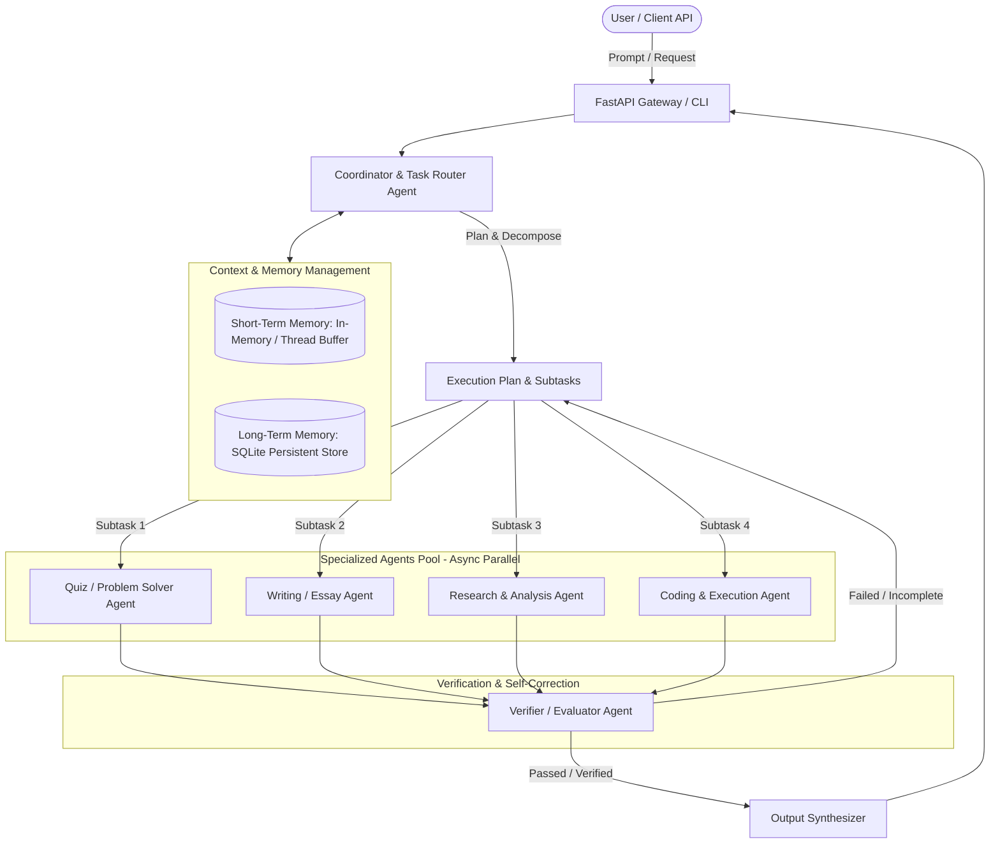

# 🤖 JARVIS Autonomous AI Agent Core

Backend sistem **Autonomous Multi-Agent AI** (seperti JARVIS) berstandar *production-grade* yang dirancang untuk mengeksekusi berbagai tugas intelektual secara mandiri—mulai dari menganalisis & menyelesaikan soal Pilihan Ganda (PG), meriset & menulis esai akademis, hingga menghasilkan dan menguji kode program secara aman.

Sistem ini mengadopsi metodologi **Hierarchical Multi-Agent with Reflection Loop** (`Plan -> Execute -> Verify -> Output`).

---

## 🏗️ 1. Arsitektur Multi-Agent



### Agen Spesialis:
1. **Coordinator Agent (JARVIS Router):** Menerima instruksi, membedah intent, dan menyusun *Execution Plan* (DAG subtasks) serta mendeteksi apakah subtasks bisa dieksekusi secara paralel.
2. **Quiz / Problem Solver Agent:** Menganalisis soal Pilihan Ganda (PG), menerapkan *Chain-of-Thought (CoT)*, melakukan eliminasi opsi satu per satu dengan alasan ilmiah, dan menentukan jawaban dengan tingkat keyakinan tinggi.
3. **Writing / Essay Agent:** Pipeline multi-tahap (penyusunan kerangka/outline $\rightarrow$ sintesis hasil riset $\rightarrow$ penulisan esai terstruktur berstandar akademik).
4. **Research & Analysis Agent:** Mengambil referensi, mencari materi pendukung, dan merangkum temuan kunci (*key findings*) secara kredibel.
5. **Coding Agent:** Menghasilkan kode program yang rapi (*clean code* + type hints), menganalisis kompleksitas waktu/ruang ($O(N)$), dan terintegrasi dengan **AST Sandbox Executor** untuk validasi sintaks & menjalankan unit test langsung.
6. **Verifier / Evaluator Agent:** Mengaudit hasil agen sebelum dikembalikan ke user. Jika hasil tidak memenuhi standar atau memiliki kesalahan logika, sistem otomatis melakukan **Self-Correction** dan mengulang perbaikan secara otonom.

---

## 📁 2. Struktur Proyek

```text
Agent AI/
├── app/
│   ├── api/
│   │   ├── dependencies.py          # Dependency injection engine
│   │   └── v1/
│   │       ├── router.py            # API V1 Router
│   │       └── endpoints/
│   │           ├── health.py        # Healthcheck endpoint
│   │           └── agent.py         # Endpoints: /run, /quiz, /essay, /coding, /memory
│   ├── core/
│   │   ├── config.py                # Konfigurasi Pydantic Settings & Env
│   │   └── llm_provider.py          # Abstraksi Google Gemini SDK & Offline Simulator
│   ├── memory/
│   │   ├── base.py                  # Interface MemoryItem & BaseMemory
│   │   ├── short_term.py            # Working Memory & Context Window
│   │   └── long_term.py             # SQLite Persistent Long-Term Memory
│   ├── tools/
│   │   ├── search_tool.py           # Pencarian referensi & knowledge base
│   │   └── code_executor.py         # AST validator & Python subprocess sandbox
│   ├── workflow/
│   │   ├── state.py                 # State model (Plan, Subtasks, Retries, Logs)
│   │   ├── verifier.py              # Evaluator & Self-Reflection Agent
│   │   └── engine.py                # Workflow Engine (Plan -> Exec -> Verify -> Output)
│   ├── agents/
│   │   ├── base_agent.py            # Base Agent abstraction
│   │   ├── coordinator.py           # Task Router & Decomposition
│   │   ├── quiz_agent.py            # Multiple Choice & Problem Solver
│   │   ├── essay_agent.py           # Academic Essay Writer
│   │   ├── research_agent.py        # Information & Reference Researcher
│   │   └── coding_agent.py          # Software Engineer & Code Tester
│   └── main.py                      # FastAPI Application Entrypoint
├── tests/
│   ├── test_agents.py               # Unit test seluruh specialized agents
│   ├── test_workflow.py             # Integration test siklus Plan->Exec->Verify
│   └── test_api.py                  # End-to-end API HTTP test
├── demo_cli.py                      # Interactive Terminal Showcase (Rich formatting)
├── requirements.txt                 # Dependensi Python
├── Dockerfile                       # Docker image container
├── docker-compose.yml               # Multi-container orchestration
├── .env.example                     # Contoh template konfigurasi
└── README.md
```

---

## ⚡ 3. Cara Menjalankan

### A. Persiapan Environment

Virtual environment sudah terpasang dan paket telah terinstal:

```bash
# Aktifkan virtual environment
source .venv/bin/activate
```

Jika ingin menggunakan live model dari Google Gemini, masukkan API Key Anda ke file `.env`:
```bash
GEMINI_API_KEY="AIzaSy..."
```
> **Catatan:** Jika `GEMINI_API_KEY` tidak diisi atau offline, sistem otomatis beralih ke mode **Intelligent Autonomous Simulator**, sehingga semua alur, pengujian, dan demo tetap dapat berjalan 100% tanpa kendala!

---

### B. Menjalankan Interactive Demo CLI

Jalankan skrip demonstrasi interaktif untuk melihat 3 workflow (PG, Esai, dan Coding) langsung di terminal dengan tampilan tabel dan status visual:

```bash
.venv/bin/python demo_cli.py
```

---

### C. Menjalankan Unit & Integration Test Suite

Jalankan seluruh pengujian otomatis dengan pytest:

```bash
.venv/bin/pytest tests/ -v
```

Hasil uji terakhir: **15 tests PASSED**.

---

### D. Menjalankan FastAPI Backend Server

Jalankan server REST API:

```bash
.venv/bin/uvicorn app.main:app --host 0.0.0.0 --port 8000 --reload
```

Akses dokumentasi interaktif Swagger UI di browser:
👉 **`http://localhost:8000/docs`**

#### Contoh Endpoint yang Tersedia:
- `POST /api/v1/agent/run` : Menjalankan tugas otonom penuh (otomatis mendeteksi tipe tugas, dekomposisi subtasks, eksekusi, verifikasi, dan output).
- `POST /api/v1/agent/quiz` : Endpoint khusus untuk menyelesaikan dan menganalisis soal pilihan ganda.
- `POST /api/v1/agent/essay` : Endpoint khusus untuk membuat kerangka dan esai akademis.
- `POST /api/v1/agent/coding` : Endpoint khusus untuk penulisan kode program dengan pengujian sandbox.
- `GET /api/v1/agent/memory/{session_id}` : Memeriksa riwayat *working memory* dan konteks sesi.
- `GET /api/v1/health` : Memeriksa status kesehatan layanan dan konektivitas LLM.

---

### E. Menjalankan via Docker Compose

```bash
docker-compose up -d --build
```

### F. Percakapan Suara & Analisis Layar

1. Buka dashboard di `http://localhost:8000`, lalu mulai panggilan JARVIS.
2. Klik **Bagikan Tab / Layar** dan pilih tab/jendela yang ingin dianalisis melalui dialog browser.
3. Saat soal terlihat, klik **Analisis yang Terlihat**. Gambar layar dikirim ke model Gemini untuk dibaca, lalu jawaban singkat ditampilkan dan dibacakan.

Analisis gambar memerlukan `GEMINI_API_KEY` dan model Gemini yang mendukung input gambar. Jangan bagikan layar yang menampilkan kata sandi atau data pribadi. Browser tidak mengizinkan aplikasi localhost membaca atau mengisi situs lain secara diam-diam; JARVIS memberikan jawaban untuk Anda tinjau, bukan mengirim formulir.
